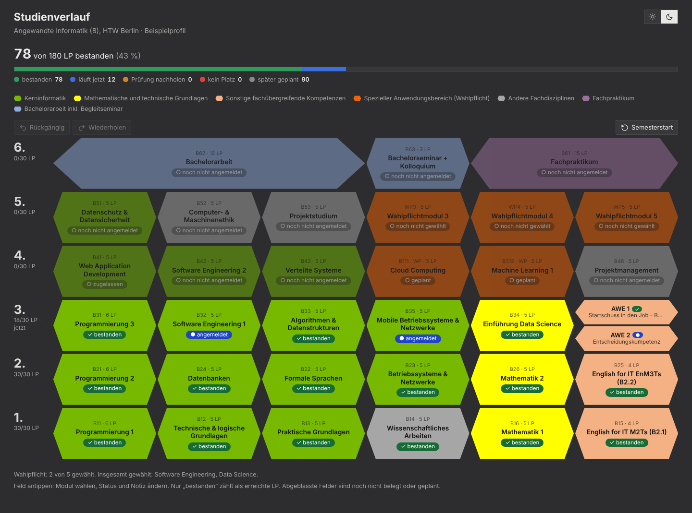
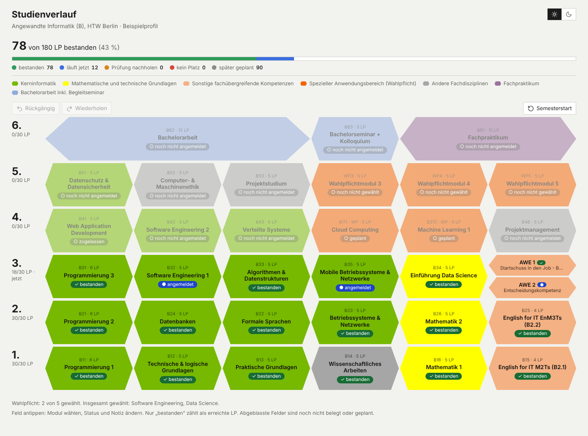

# HTW Studienplaner

[](https://github.com/eljakj/htw-studienplaner/actions/workflows/ci.yml)

**Live-Demo:** <https://eljakj.github.io/htw-studienplaner/>

Interaktiver Studienverlaufsplan für den Bachelor **Angewandte Informatik (B)** an der HTW Berlin. Jedes Modul ist ein Sechseck in den Farben des Studienverlaufsplans. Ein Klick setzt den Status, und die Leistungspunkte (LP) werden mitgezählt. Dein Plan bleibt in deinem Browser: kein Konto, kein Server-Speicher, kein Tracking.

**English:** A static single-page web app (one HTML file, vanilla JS, no framework) to plan the Bachelor programme "Angewandte Informatik (B)" at HTW Berlin. Each module is a hexagon; one click sets its status and the credit points are counted. The plan stays in your browser (`localStorage`): no account, no server-side storage, no tracking. The module catalog is written in Python and embedded at build time. Tests: pytest (unit) and Playwright (E2E); delivery: Docker with nginx, GitHub Actions, image on GHCR. The rest of this page is in German.

> Inoffizielles Projekt, kein Angebot der HTW Berlin. Alle Angaben ohne Gewähr; maßgeblich sind die Studienordnung (SPO) und das LSF.



<details>
<summary>Helles Theme</summary>



</details>

Die Screenshots zeigen einen **fiktiven** Beispielplan.

## Funktionen

**Planen**
- Status pro Modul: bestanden, läuft jetzt, Prüfung nachholen, kein Platz, später geplant. Nur bestandene Module zählen zu den 180 LP.
- Auswahl per Dropdown: 5 Wahlpflichtplätze (19 Module), 2 AWE-Plätze (73 Kurse), 2 Fremdsprachenplätze (22 Kurse). Hinweise auf notwendige und empfohlene Voraussetzungen.
- Studienbeginn (Sommer- oder Wintersemester plus Jahr) bestimmt das aktuelle Fachsemester („jetzt“), nach dem Akademischen Kalender der HTW. Ab dem 7. Semester steht dort „über Regelstudienzeit“.
- Rückgängig und Wiederholen (Strg+Z, Strg+Y), Semesterstart (alle Plätze leeren), dunkles und helles Theme.

**Starten**
- Beim ersten Besuch fragt eine Karte: „Eigenen Plan starten“ (drei Klicks), „Beispiel ansehen“ oder „Plan importieren“.
- Der Beispielplan hat **erfundene** Daten, ein Banner weist darauf hin, und es wird nichts gespeichert. Er ist auch über `…/#beispiel` erreichbar.

**Sichern und verwalten**
- **Mehrere Pläne** pro Browser mit Umschalter, Name und Untertitel. Jeder Tab kann einen anderen Plan offen haben.
- **Löschen** mit Bestätigung direkt in der Seite und „Rückgängig“, solange die Seite offen bleibt.
- **Export und Import** als JSON-Datei, komplett im Browser. Der Import prüft die Datei, zeigt eine Vorschau („47 LP bestanden – übernehmen?“) und ändert vorher nichts. Ungültige Dateien werden mit Grund abgelehnt, Texte daraus werden nie als HTML gesetzt.
- **Sicherungs-Erinnerung**, wenn ein Plan seit 30 Tagen nicht exportiert wurde.
- **Katalog-Updates:** Gibt es ein gespeichertes Modul nach einem Katalogwechsel nicht mehr, meldet die Seite das einmal und speichert den bereinigten Plan. Status und Notizen bleiben erhalten.
- Kann der Browser nicht speichern (privates Fenster, gesperrter Speicher), zeigt die Seite sofort einen Hinweis und bleibt benutzbar.

## Schnellstart

Du brauchst Python 3 und Git. Der Build benötigt keine weiteren Pakete.

```bash
git clone https://github.com/eljakj/htw-studienplaner.git
cd htw-studienplaner
python3 build.py              # Windows: python build.py
```

`build.py` schreibt `dist/index.html`, eine einzelne Datei, die du direkt im Browser öffnest. Der Build ist immer neutral: Er enthält nur den Katalog und den erfundenen Beispielplan, keine persönlichen Daten.

## Entwickeln und testen

```bash
python -m venv .venv
source .venv/bin/activate         # Git Bash und WSL2: .venv/Scripts/activate; PowerShell: .venv\Scripts\Activate.ps1
pip install -r requirements-dev.txt
python -m playwright install chromium

python -m pytest                  # Unit-Tests
python build.py && python -m pytest tests/e2e    # Browser-Tests mit Playwright
```

Über 400 Tests prüfen Katalog, Build, Speicher, Import und Export, Profile, Sicherungs-Erinnerung, nginx-Konfiguration und die Workflows. Jeder Browser-Test schlägt bei JavaScript-Fehlern und bei Anfragen an fremde Server fehl. Mehr in [CONTRIBUTING.md](CONTRIBUTING.md).

## Docker und Deployment

```bash
docker build -t htw-studienplaner .
docker run --rm -p 8080:8080 htw-studienplaner       # http://localhost:8080
```

Das Image enthält nur die neutrale Seite und läuft mit nginx ohne Root-Rechte. GitHub Actions veröffentlicht es nach jedem erfolgreichen CI-Lauf auf `main` als `ghcr.io/eljakj/htw-studienplaner:latest`; dieselbe Seite geht an GitHub Pages. Der Betrieb mit `docker compose` steht in [docs/deployment.md](docs/deployment.md).

## Datenschutz

- Dein Plan liegt nur im `localStorage` deines Browsers. Es gibt kein Konto und keinen Server-Speicher.
- Die Seite lädt nichts von anderen Servern und setzt keine Cookies. Eine Content Security Policy erlaubt nur das eigene Skript.
- Der nginx-Container schreibt kein Zugriffsprotokoll. Besucheradressen werden also nicht gespeichert. Hinter einem Proxy oder Dienst (zum Beispiel Cloudflare) gelten dessen eigene Protokolle.
- Exportdateien enthalten deinen Studienstand. Sie stehen in der `.gitignore` (`studienverlauf-*.json`) und gehören nie ins Repository.

## Architektur

```
src/catalog.py  +  src/index.tpl.html  +  src/semester.js  +  src/exchange.js
                                |
                            build.py
                                |
                        dist/index.html  -->  Docker-Image (nginx)  -->  GHCR  -->  docker compose
                                         -->  GitHub Pages
```

Ein Python-Build bettet den Katalog und zwei kleine JavaScript-Module in eine HTML-Vorlage ein. Alles Weitere, also Zustand und Darstellung, passiert im Browser. Ausführlich: [docs/architecture.md](docs/architecture.md). Die Planung steht im [PRD](docs/PRD.md).

Entscheidungen:

- [ADR-0001: Eine statische HTML-Datei, Vanilla JS, Katalog in Python](docs/adr/0001-single-static-file.md)
- [ADR-0002: Export und Import statt Konto oder Sync](docs/adr/0002-export-import-instead-of-sync.md)
- [ADR-0003: Content Security Policy mit Skript-Hash](docs/adr/0003-content-security-policy.md)
- [ADR-0004: Ein neutraler Build für alle](docs/adr/0004-one-neutral-build.md)
- [ADR-0005: Mehrere lokale Profile in einem Speicherschlüssel](docs/adr/0005-local-profiles.md)

## Status

Version 1.0 ist funktional vollständig. Nicht geplant sind ein Konto, Sync zwischen Geräten und ein Nur-Lese-Link (siehe ADR-0002).

Offen:

- Für Quantencomputing, Spezielle Anwendungen der Informatik und Interdisziplinäres Projekt kennt das LSF noch keine B-Nummer. Der Katalog führt sie unter eigenen Kürzeln, bis Studienbüro oder SPO Klarheit schaffen.
- Wann der alte Speicherschlüssel `studienverlauf-ai-v1` gelöscht wird. Bis dahin bleibt er unverändert stehen.
- Ob für die öffentliche Seite ein Impressum und ein Datenschutzhinweis nötig sind.

## Mitmachen

Kleine Schritte: ein Issue, ein Branch, ein Pull Request. Regeln und Befehle stehen in [CONTRIBUTING.md](CONTRIBUTING.md). Code, Commits, Issues und Pull Requests sind auf Englisch, die Oberfläche und dieses README auf Deutsch.

## Lizenz

[MIT](LICENSE)
