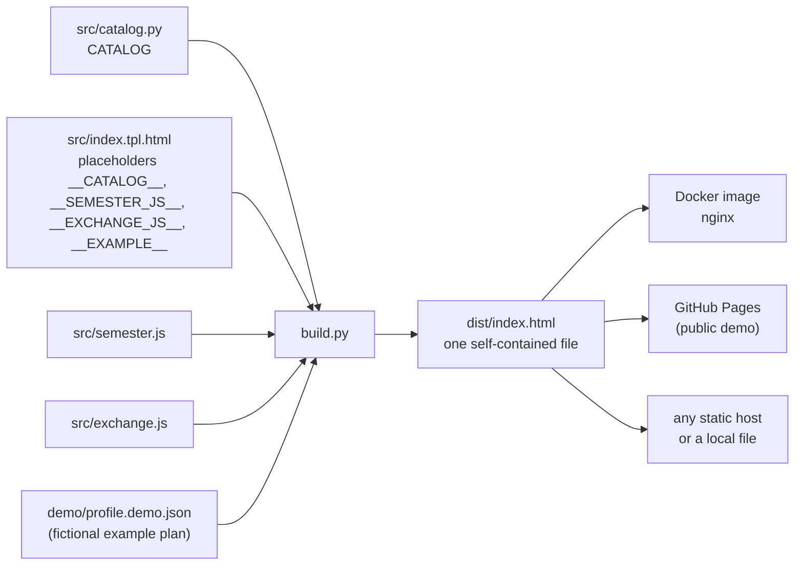
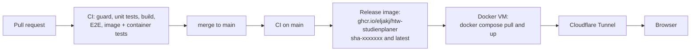

# Architecture

The app is one static HTML file. A Python build embeds the module catalog into a page template; everything else (state, rendering) happens in the browser. There is no backend.

The decisions behind this are in the ADRs: [one static file](adr/0001-single-static-file.md), [export and import instead of sync](adr/0002-export-import-instead-of-sync.md), [Content Security Policy](adr/0003-content-security-policy.md), [one neutral build for everyone](adr/0004-one-neutral-build.md), [local profiles in one storage key](adr/0005-local-profiles.md). The product plan is in the [PRD](PRD.md).

## Parts

| Path | Role |
| --- | --- |
| `src/catalog.py` | The catalog: 34 slots of the study plan, 19 elective modules, 73 AWE courses, 22 language courses. Validated when imported. |
| `src/index.tpl.html` | The page: HTML, CSS and one script (vanilla JS). Contains the placeholder `__CATALOG__`. |
| `src/semester.js` | Pure functions for the current semester: no DOM, no clock, the date is passed in. Embedded into the page at the placeholder `__SEMESTER_JS__`. |
| `src/exchange.js` | Pure functions for the export and import file: `exportFileName()`, `buildExport()`, `parseImport()`. No DOM, no clock, no storage; the date is passed in. Embedded at the placeholder `__EXCHANGE_JS__`. `parseImport()` checks the shape of an import file (see Import below), `importTooLarge()` the size. |
| `build.py` | Fills the template with the catalog, `src/semester.js` and `src/exchange.js` and writes `dist/index.html`. |
| `tests/unit` | Unit tests for the catalog, the build, the nginx config and the image tags. |
| `tests/e2e` | Browser tests (Playwright) and checks against the running container. |
| `docker/nginx.conf`, `Dockerfile` | The image: the built page served by nginx as a non-root user. |
| `deploy/compose.yaml` | Deployment on the Docker VM, see [deployment.md](deployment.md). |
| `.github/workflows` | CI, publishing of the image, publishing the page to GitHub Pages. |

## Build flow

1. `catalog.py` checks itself when it is imported (`validate()`): unique slot IDs, known categories, 30 credit points per semester (180 in total), and prerequisites that point to existing modules.
2. `build.py` serializes the catalog to JSON (`</` is escaped so the data cannot close the script tag) and replaces the placeholder. The template must contain the placeholder exactly once, otherwise the build fails.
3. `build.py` computes the SHA-256 hash of the inline script and writes a `<meta>` Content Security Policy that allows exactly this script (ADR-0003).
4. The output has LF line endings and no timestamps. The same input always gives the same bytes, so two builds can be compared byte for byte.

The build is always **neutral**: every module starts as "planned", and there is no option for personal start values (`--demo` and `--profile` were removed, ADR-0004). Your own plan lives in the browser and moves between browsers with the export/import file. The only fictional data in the page is the example plan. Unit tests check that the build accepts no profile option, that the Docker image is built from the neutral build only, and that the Pages workflow builds exactly `python build.py --out site/index.html` (PRD, requirement A1).

## Runtime and storage

- The script reads the embedded catalog, draws the plan and keeps the state of each slot (status, note, chosen module).
- The state is saved in the browser's `localStorage` under the key `studienverlauf-ai-v2`; the theme choice is saved under `studienverlauf-theme`. Nothing is sent to a server.
- Schema v2 (see the PRD): `{v, active, profiles: {p1: {name, start, rev, m, names, [subtitle], [created], [lastExport]}}}`. Only deviations from the catalog are stored (`m` = status, note and chosen module per slot). The fields in brackets are written only when they are set. Until the start choice exists, `start` is `null` and the profile is called "Mein Plan".
- Study start: the page keeps `start` (`{term: "SoSe" | "WiSe", year}`, or `null`) in the profile. `currentSemester(start, today)` in `src/semester.js` returns the semester that is marked "jetzt": none without a start or if the start is ahead (hint "Studium beginnt im ..."), 1 to 6 while the study runs, and 6 with the hint "über Regelstudienzeit" from the 7th semester on. Terms follow the HTW academic calendar: Sommersemester 1 April to 30 September, Wintersemester 1 October to 31 March (checked against the calendars SoSe 2025, SoSe 2026 and WiSe 2026/27); "now" follows the semester period, not the start of lectures. An incomplete or invalid input is not stored.
- First visit: the card `#welcome` ("Wie möchtest du starten?") is shown above the plan as long as no plan is stored, that is, there is no v2 key (not even an unusable one) and nothing was chosen or changed in this session. "Eigenen Plan starten" asks for the study start in three clicks (start, term, "Los"; the year field gets the focus after the term) and stores it in the profile. Changing the plan in any other way also counts as having a plan. Other tabs hide the card through the `storage` event. The option "Beispiel ansehen" opens the example plan (below); "Plan importieren" opens the file dialog of the import (below).
- Example plan (sandbox, A4): `demo/profile.demo.json` holds a fictional plan (`meta.currentSem` = 4, statuses on catalog modules, no SPO or LSF facts). `build.py` turns it into the state `{currentSem, m, names}` with `catalog.example_state()` and embeds it as a second data block (`<script type="application/json" id="example">`, placeholder `__EXAMPLE__`). The block is in every build, so production and the demo show the same example. The example is date-independent: the page calls `startForSemester(currentSem, today)` (inverse of `currentSemester`) to get a start term that makes the 4th semester the running one.
- Sandbox mode: entered through the welcome card, the footer link or the URL hash `#beispiel` (also on a fresh navigation, also with an own plan). The own plan is only put aside in memory (`kept`), the example state is loaded through `sane()`, undo history and open panel are reset. While `sandbox` is set, `save()` and `touch()` return at once (two independent guards): nothing is written, and changes do not count as having chosen a plan. A `storage` event during the sandbox is remembered (`kept.stale`) and the own plan is reloaded when the sandbox is left; otherwise the kept state is put back, so it also works with blocked storage. "Eigenen Plan starten" in the banner leaves the sandbox (without a stored plan: step 2 of the welcome card). The browser's back button also leaves it. Leaving removes the hash with `history.replaceState`.
- Export (A7a): the button `#export` builds the file in the browser with `buildExport()` and downloads it through a `Blob` and a temporary `<a download>`; no request leaves the page and nothing is written to the storage. The file holds exactly one profile: `{app: "htw-studienplaner", v: 2, exportedAt (UTC, ISO 8601), catalog (meta.catalog of the catalog, e.g. "LSF WiSe 2026/27"), profile: {name, start, m, names}}`. The local `id` and `rev` are not exported, the import gives the plan new ones. `m` holds only deviations from the catalog, like the storage. `app` and `v` let the import recognize its own files. The file name is `studienverlauf-<name>-<date>.json` with the local date; the name is made safe (umlauts to ae/oe/ue/ss, other characters to `-`, at most 40 characters, `plan` if empty). In the example sandbox the button is disabled and `exportPlan()` refuses as well. Export works with blocked storage, because it reads the plan from memory.
- Import (A7b): the buttons `#importBtn` (tools row) and `#wImport` (first-visit card) open a hidden `<input type="file">`. A file over 1 MB (`IMPORT_MAX_BYTES`) is rejected before it is read. `parseImport(text)` in `src/exchange.js` checks only the shape and returns the file's values unchecked or a named error (`json`, `shape`, `app`, `version`); a byte order mark is ignored. Two kinds are accepted: **v2** (`app` = "htw-studienplaner", `v` = 2, `profile.m` an object) and **v1** (no `app` and no `v`, an object `m`, optional `names`: the shape the old page stored under `studienverlauf-ai-v1`; no name, no start). A file with `app` or `v` but another app, or another `v`, is rejected, so the raw storage value is not accepted either. The page then runs `sane()` on the content (the same function that checks the stored plan; it now also returns a `report` of what it dropped), `saneStart()` on the start, cuts the name to 40 characters, and drops entries that equal the catalog (as the storage does). The result waits in `pending` and is shown in the box `#importBox`: title "N LP bestanden – übernehmen?", name, start, catalog version (a different version is only pointed out, updating is a separate step), a list of discarded values, and a warning with the current LP if the plan is not empty. Everything is set with `textContent`. Only "Übernehmen" changes the plan: it replaces name, start, `m` and `names` of the active profile, clears the undo history, closes an open panel and saves through `touch()` (so a first-visit card disappears). Cancelling, an error, or starting the example sandbox discards `pending`. Nothing is written before "Übernehmen". The import is disabled in the sandbox and the file handler ignores a file there too. There is no undo for an import; the preview names what is replaced.
- Saving is silent and happens only after a change, never on a plain visit. The one exception is the migration below.
- Migration: if there is no v2 key (not even an unusable one) and the old key `studienverlauf-ai-v1` holds something usable after `sane()`, it is saved once as the profile "Mein Plan" (`start: null`, `rev` from v1). The v1 key is never changed or deleted, it stays as a fallback. Corrupt, empty or reset v1 data is ignored. Open: when the v1 key will be removed (the PRD says "one version").
- Several tabs: the last change wins. Other open tabs reload through the `storage` event and drop their undo history.
- Stored data is checked on load (`sane()` in the page): unknown slots, statuses and modules are dropped (only own keys count, so names like `toString` are unknown too), notes are cut to 28 characters. Values are escaped before they are written into the page.
- On load the page tries to write and remove a test key. If that fails (private window, blocked storage), the notice `#nostore` ("wird nicht gespeichert") is shown at once, before any change, and the page stays fully usable; nothing is written then. If saving works on load but a later write fails, the small notice `#saveerr` ("Speichern fehlgeschlagen") with a retry button is shown instead.
- Catalog update on load: `sane()` also returns a `report` of what it dropped (unknown slots, modules, statuses, notes). If a chosen module or a slot no longer exists in the catalog (for example after a new semester), the page shows the notice `#catnote` once ("Der Katalog hat sich geändert. Diese Einträge gibt es nicht mehr und wurden entfernt: ..."), and the cleaned plan is saved at once. The next load has nothing left to drop, so the notice does not come back. Status and notes of a slot stay when only its module was dropped. The notice is not shown in the example sandbox, and `meta.catalog` ("LSF WiSe 2026/27") is the version that goes into the export file.
- Local profiles (A8, A12, ADR-0005): the bar `#profbar` appears as soon as a plan exists. `#profSel` switches between plans, "Neuer Plan" adds one (at most 20, `MAX_PROFILES`), "Name ändern" opens the name (40 characters) and the optional subtitle (80 characters, shown in the page head instead of the catalog subtitle). Every change is saved at once, so switching loses nothing. Each tab has its own active plan (`loadState(prefer)`); `store.active` is only the plan that the next new tab opens. If the browser cannot write, all plans are kept in memory (`memStore`) for this session. Profile IDs match `/^p\d{1,6}$/`; a deleted ID can be given out again.
- Deleting a plan (A9): "Löschen" shows the confirmation `#profConfirm` inside the page (never `window.confirm`; the default focus is on "Abbrechen"). After "Löschen" the record is removed from the storage and kept in memory in `deleted`; the bar `#profUndo` offers "Rückgängig" for this session only. Deleting the last plan returns to the first-visit card and does not bring back the old v1 key (an existing v2 key blocks the migration, even with `profiles: {}`). Importing has no undo.
- Backup reminder (A10): `backupDue(lastExport, created, now, days)` in `src/exchange.js` (pure, the date is passed in) is true when 30 days (`BACKUP_DAYS`) have passed since the last export, or since `created` if the plan was never exported. `created` is set on the first change of a plan, when a plan is added or imported; older plans get it on their first change. The notice `#backupnote` is not shown for an empty plan, in the example sandbox, or after "Später" (for this visit only). Every export of a stored plan sets `lastExport`; an export on the first visit writes nothing.
- Export file and subtitle (A12): `buildExport()` adds `subtitle` as the last key of `profile` only if it is not empty; the import brings it back.

## Security and privacy

- No account, no cookies, no requests to other origins: no external fonts, scripts or images.
- Content Security Policy in two places: a `<meta>` tag in the page (script hash, `default-src 'none'`) and a header from nginx (`frame-ancestors 'none'`, `base-uri`, `form-action`). Both apply.
- nginx also sends `X-Content-Type-Options`, `Referrer-Policy: no-referrer` and `Permissions-Policy`, hides its version, and runs without root rights.
- nginx writes no access log and only critical errors, so visitor addresses are not stored.
- The image contains only the neutral build; CI compares it byte for byte with a fresh build. A guard step fails if files like `profile.json` or `studienverlauf-*.json` are tracked by git.

## Test strategy

| Level | What it checks | Where |
| --- | --- | --- |
| Unit | Catalog consistency, build output (placeholder, determinism, LF, no external URLs, CSP hash, no profile option), semester, export/import and backup functions, stored-data fixtures, nginx config guards, image tag rules, workflow guards | `tests/unit`, `python -m pytest` |
| Browser (E2E) | Page loads, credit points, undo and redo, reload keeps the state, theme, start choice, example sandbox, export, import, catalog update, profiles and deleting, backup reminder, migration, blocked storage, separate browser contexts do not share state, no cookies. Every test fails on JavaScript errors, CSP violations and requests to other hosts. | `tests/e2e` |
| Container | Headers, `/healthz`, gzip, 404, the same E2E tests against the running image | CI, or `E2E_BASE_URL=... pytest tests/e2e` |

The E2E tests build the page themselves and serve it on a free local port, or use `E2E_BASE_URL`. Each test gets a fresh browser context.

## CI, release and deployment

- `main` is protected: changes come through a pull request, and the CI check `test` must be green.
- The image is built and published only after CI succeeded on `main` (or for a version tag on a commit with a green CI run).
- Updates on the VM are manual: `docker compose pull && docker compose up -d`. Details and rollback: [deployment.md](deployment.md).
- The same neutral page is published to GitHub Pages by `.github/workflows/pages.yml`, also only after CI succeeded on a push to `main`. One-time setup: Settings, Pages, Source "GitHub Actions". Pages cannot send HTTP headers, so there only the `<meta>` Content Security Policy applies (nginx adds the header policy in the container).
